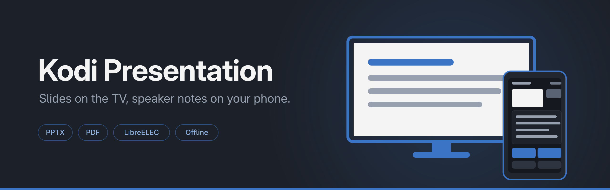

# kodi-presentation

Give a talk straight from your TV — on a LibreELEC box, without a laptop.

The add-on renders `.pptx` and `.pdf` files on the device itself, shows the
slides fullscreen on the TV, and mirrors the speaker notes, the next slide and
a timer to the presenter's phone. The audience sees nothing but the slide.

## Requirements

- LibreELEC 12.x with Kodi 21 (Omega) on **aarch64** — developed and verified on
  a Raspberry Pi 5
- Nothing else. No internet at runtime, no libraries to install, no second
  machine.

Rendering is done by two bundled, statically linked binaries:
[DeckCraft](https://github.com/storytold/deckcraft) for PowerPoint files and
`pdfrender` for PDFs — a small program in `tools/pdfrender` built on
[hayro](https://crates.io/crates/hayro). Both draw on the CPU (`vello_cpu`) and
therefore need neither Vulkan nor X11, which is exactly why they work on
LibreELEC.

## Installation

```bash
./tools/build-deckcraft.sh   # DeckCraft for .pptx, once, ~2 minutes
./tools/build-pdfrender.sh   # PDF renderer, ~1 minute
./build.sh                   # produces dist/script.presentation-<version>.zip
```

Both binaries are built from source, statically against musl, with no C
toolchain required. Nothing precompiled is shipped. The versions are pinned
(`tools/deckcraft.version`, `hayro = "0.9"` in `tools/pdfrender/Cargo.toml`), so
an update is a deliberate act and cannot silently change how your slides look.

Copy the ZIP to the device and install it in Kodi under
*Add-ons → Install from zip file*.

Then create a folder for your presentations (default `/storage/presentations`)
and put your files there. Network shares work too: the add-on copies a file from
`smb://` or `nfs://` to local storage before rendering it.

## Using it

| Action | Remote control |
|---|---|
| Next slide | Right, Down, OK |
| Previous slide | Left, Up |
| Slide list for jumping | Info |
| Black screen on / off | Context menu |
| Quit | Back |

On startup a dialog shows the URL of the presenter view. After you confirm it, a
QR code pointing to the same address is laid over the first slide. Open it on
your phone and you get the presenter view: current and next slide, the notes in
large type, a timer, and buttons for navigating and for the black screen. The
first key press hides the QR code — from then on the TV shows nothing but
slides, with no overlays at all.

## Security of the presenter view

The phone page is served over **unencrypted HTTP** on the local network. The URL
contains a random token that is valid only for the running presentation; without
a valid token the server answers 404.

That stops someone from stumbling onto the page. It does **not** protect against
an attacker on the same Wi-Fi: anyone who can read the network traffic sees the
token and can drive the presentation. For the intended use — a talk on your own
network — that is appropriate. For sensitive material on a foreign network it is
not.

## Settings

| Setting | Default | Meaning |
|---|---|---|
| Language | Automatic | follows Kodi's UI, or fixed German or English |
| Presentation folder | `/storage/presentations` | where the add-on looks for decks |
| Render resolution | 1920×1080 | 960×540 for 720p devices, 3840×2160 for 4K |
| Port for the phone page | 8099 | if taken, the next three ports are tried |
| Cache limit | 2 GB | older rendered decks are removed beyond this |

A deck that has been rendered once starts instantly next time. If the file
changes, it is re-rendered automatically.

## Languages

The add-on speaks German and English — on the TV, in the dialogs and on the
phone page. The default *Automatic* follows Kodi's UI language; you can also fix
one language independently of Kodi.

All strings come from `tools/texte.json` and are generated from it into both
`strings.po` files by `tools/baue-sprachen.py`. A string that exists in only one
language is therefore impossible, not merely unlikely.

## Supported formats

| Format | Slides | Speaker notes | Renderer |
|---|---|---|---|
| `.pptx` | yes | yes | DeckCraft |
| `.deckcraft` | yes | yes | DeckCraft |
| `.pdf` | yes | **no** | pdfrender |

**PDFs carry no speaker notes.** They play back fine on the TV, but on the phone
the notes panel stays empty and you get only the page counter, the preview and
the timer. PDF is a page-description format: it records what is painted on the
page, and a PowerPoint export simply drops the notes, which live in a separate
part of the `.pptx` package. For a talk with notes, `.pptx` is the better format.

ODP, legacy PPT and Keynote are **not** read — verified on the device, DeckCraft
rejects them explicitly, and there is no converter on LibreELEC. If you have such
files, export them to PPTX or PDF on a desktop machine first.

PDFs are rendered to a fixed target width rather than by a scale factor: a deck
with a page width of 1440 points would otherwise come out at 2880 pixels, four
times what a 1080p TV can show. A single page is capped at 40 megapixels — about
five times 4K. A PDF that declares pages far larger than that (a plotter drawing,
a poster) is refused with an error naming the page, rather than being rendered
until the device runs out of memory.

## Limitations

- **No slide transitions or animations.** Slides are hard cuts.
- **No presenter view on a second display.** Kodi drives only one output under
  LibreELEC; the second screen is your phone.
- **No text from the add-on appears on the TV.** During development, labels and
  text boxes stayed invisible in this window across several fonts and control
  types. The slide counter, title and notes therefore live on the phone — which
  is where they belong during a talk anyway. (That finding came from Kodi
  screenshots that later turned out to be unreliable, so whether text would in
  fact work is worth re-checking.)
- **DeckCraft is alpha.** Simple decks with text, bullets, tables and images
  render cleanly. Corporate templates with SmartArt, charts or embedded fonts may
  come out differently — so click through your deck once before an important
  talk.

## Development

```bash
python -m pytest              # 178 tests, no binary needed
python -m pytest -m binary    # additionally against the real deckcraft-cli
cargo test --manifest-path tools/pdfrender/Cargo.toml
```

The Kodi modules are stubbed in `tests/conftest.py`, so the suite runs on any
machine without Kodi.

The DeckCraft version in use is recorded in `tools/deckcraft.version` and checked
out as a git tag at build time — changing versions is a deliberate change, not a
surprise.

The code, its comments and the design documents in `docs/` are written in German.

## License

MIT, see [LICENSE](LICENSE).

The bundled `deckcraft-cli` comes from
[storytold/deckcraft](https://github.com/storytold/deckcraft) and is MIT or
Apache-2.0. PDF rendering is done by [hayro](https://crates.io/crates/hayro),
also Apache-2.0 or MIT.
